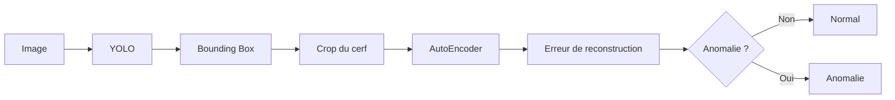

# 🦌 Deer Detection & Anomaly Detection

Projet d'intelligence artificielle visant à détecter des cerfs dans des images et à identifier des anomalies à l'aide de **YOLO** et d'un **AutoEncoder**.

## 🎯 Pipeline

Le système fonctionne en deux étapes :

1. **YOLO** détecte les cerfs dans l'image.
2. Le cerf détecté est **crop** à partir de sa bounding box.
3. Le crop est envoyé à l'**AutoEncoder**.
4. L'AutoEncoder calcule une **erreur de reconstruction**.
5. Cette erreur permet de déterminer si le cerf est **normal ou anomal**.



## 🧠 Modèles

### YOLO

Utilisé pour détecter les cerfs et obtenir leurs **bounding boxes**.

### AutoEncoder

Utilisé pour analyser les crops des cerfs et détecter les observations qui s'écartent des données normales.

## 📁 Structure

```text
project/
├── data/
├── models/
├── scripts/
│   ├── yolo/
│   ├── autoencoder/
│   └── pipeline.py
├── notebooks/
├── requirements.txt
└── README.md
```

## 🛠️ Technologies

- Python
- YOLO
- PyTorch
- OpenCV
- NumPy
- Roboflow

## 🚀 Objectif

Créer un pipeline capable de passer automatiquement de :

**Image → Détection du cerf → Crop → AutoEncoder → Détection d'anomalie**